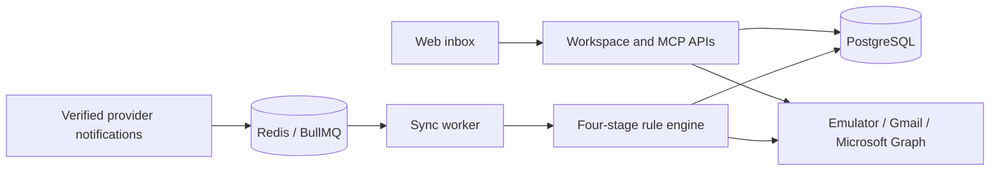

# Open Inbox Zero

Open Inbox Zero is an MIT-licensed email assistant and split-inbox application. It can organize mail with rules, track replies, create drafts, help manage newsletters, and expose mailbox tools through MCP. A synthetic local demo runs without Google or Microsoft credentials and without a paid AI key.

**Project status:** the local emulator and automated tests run, but this project has not completed its full architecture/security audit. Real Google and Microsoft sign-in, notifications, and end-to-end mailbox behavior have not been verified against live accounts. Review [STATUS.md](STATUS.md) before using it with sensitive mail.

## Local demo

Requirements: Node.js 22 or newer and pnpm 11.17.0. The initial dependency installation needs network access.

```sh
pnpm install
pnpm local:start
```

Open <http://127.0.0.1:3000>. The launcher starts an embedded PostgreSQL database, seeds `developer@example.com` and `developer@outlook.test` once, and starts the web app and worker. Existing demo data is not reset on restart. Local data stays in `.local-data/`; stop the process with Ctrl-C. Initial installation time depends on the machine and network.

## How it fits together



The matcher checks thread and system signals, deterministic rules and sender groups, a cold-email gate, then AI rule selection. Draft generation is a separate step. Automated actions are recorded before provider calls and may be undone; protected-sender and spoofing guards restrict automatic archive and outbound actions. Hybrid deterministic + AI rules using AND still require AI selection. See [how it works](docs/how-it-works.md).

## Evaluation

`pnpm eval` runs 60 synthetic messages through the rule pipeline in a temporary PostgreSQL database using the deterministic offline adapter. It writes [apps/web/data/eval-report.json](apps/web/data/eval-report.json), displays aggregate results in Analytics, and exits with an error when a required gate fails.

The recorded run matched 60/60 expected rules, correctly identified 8/8 cold predictions, rejected 8/8 tested unsafe unsubscribe requests, recorded 0/8 VIP archives, got 60/60 reply states right, and recorded 0 unauthorized sends across 12 adversarial messages. The eight learned-group cases were pre-seeded. These figures describe this synthetic fixture only; they are not estimates of real-world accuracy, live-model performance, or successful legitimate unsubscriptions.

## Self-hosting with Docker

A local Docker smoke test built the image and started the services; authenticated live-provider behavior has not been verified. Compose starts PostgreSQL 16, Redis 7, a schema setup job, the web app, and a worker. Docker does not use the embedded local demo launcher.

1. Copy `.env.example` to `.env`. Set a long random **URL-safe** `POSTGRES_PASSWORD`. Generate `BETTER_AUTH_SECRET` and `TOKEN_ENCRYPTION_KEY` independently using `openssl rand -base64 32`; preserve the encryption key for as long as encrypted tokens are needed.
2. Set `BETTER_AUTH_URL` to the public HTTPS origin and configure Google and/or Microsoft OAuth credentials. Register callback URLs ending in `/api/auth/callback/google` and `/api/auth/callback/microsoft` respectively. Grant the mail permissions requested by the app. For Gmail notifications configure the Pub/Sub variables in `.env.example`; Microsoft subscriptions need a publicly reachable HTTPS callback.
3. Run `docker compose up --build`. The web port binds to `127.0.0.1:3000`; place a properly configured HTTPS reverse proxy in front of it. PostgreSQL and Redis are internal to the Compose network. Back up the database and encryption key together.
4. Sign in, connect a mailbox, and monitor the worker and health endpoint. The first sync is limited to 200 threads. Expired Gmail history, expired Microsoft subscriptions, uncertain external actions and persistent synchronization locks can require operator recovery. Configure and test provider notification delivery before relying on it.

Compose uses `prisma db push` during startup, which is suitable for an initial setup but is not a substitute for a reviewed production migration and backup process. Never use `docker compose down -v` unless you intend to delete the database and queue volumes.

For a zero-credential demonstration, use `pnpm local:start` instead of the Docker configuration. `LLM_PROVIDER=emulator` is the default in the example; optional Google, OpenAI, Anthropic, and Ollama settings are listed there. The public `/api/health` endpoint is inexpensive; send `Authorization: Bearer <HEALTH_TOKEN>` for detailed checks. Detailed provider checks cover at most ten accounts and report partial coverage beyond that.

## MCP

After signing in, open **Assistant access keys**, create a key, and save it immediately. The secret is shown once; only its hash is stored. Each key grants the assistant access to the owner's connected accounts. Revoke it in the same screen when no longer needed.

The HTTP endpoint is `https://YOUR_HOST/api/mcp`, with an `Authorization: Bearer YOUR_KEY` header. The six tools list/read threads, create or update reply drafts, run rules, unsubscribe with confirmation, and undo an executed rule. Tool actions use the account's existing rules and safety checks.

For Claude Desktop, add a custom remote connector and supply the URL and authorization header using [Anthropic's connector instructions](https://support.claude.com/en/articles/11175166-get-started-with-custom-connectors-using-remote-mcp). For Claude Code, follow its [HTTP MCP setup](https://code.claude.com/docs/en/mcp); for example:

```sh
claude mcp add --transport http open-inbox-zero https://YOUR_HOST/api/mcp \
  --header "Authorization: Bearer YOUR_KEY"
```

Treat the configured key as a secret: commands and client configuration can retain it. Use a private host and HTTPS, and revoke a key if exposed. Client compatibility and live provider access have not been independently verified here.

## Development and license

Run `pnpm lint`, `pnpm typecheck`, `pnpm test`, `pnpm eval`, and `pnpm build`. See [CONTRIBUTING.md](CONTRIBUTING.md), [SECURITY.md](SECURITY.md), [the architecture](ARCHITECTURE.md), and [the current status](STATUS.md). The project is licensed under the [MIT License](LICENSE); dependencies retain their own [licenses](docs/THIRD_PARTY_LICENSES.md).
