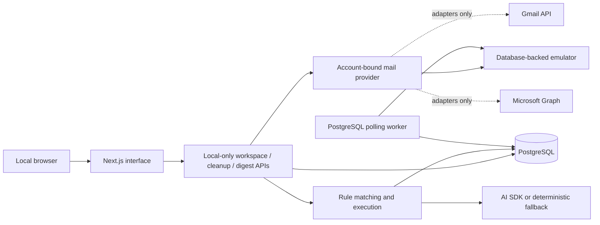

# Current architecture and technology

Snapshot: 2026-11-11, application commit `cd76041`. This describes implementation in the repository, not an assurance that it is production-ready. See [capabilities and roadmap](CAPABILITIES_AND_ROADMAP.md) for open work.

Solid paths describe the local demo. Gmail and Outlook adapters exist and have mocked tests, but live account sign-in, credential lifecycle, production worker resolution and end-to-end provider use are not yet in place.

## Workspace and runtime

| Area | Present in the repository | Important qualification |
| --- | --- | --- |
| Monorepo | pnpm workspaces, Turborepo, TypeScript; Node.js 22+ | See [root package.json](../package.json) and [workspace configuration](../pnpm-workspace.yaml). |
| Web application | Next.js 16.4.5 App Router, React 19.3.0, Tailwind CSS, Lucide icons, cmdk, TanStack virtual list, Recharts | The UI and API currently serve local emulator accounts, not authenticated real mailboxes. |
| Database | PostgreSQL and Prisma 6; schema at [schema.prisma](../apps/web/prisma/schema.prisma) | Local startup can run embedded PostgreSQL; the architecture does not use a SQLite fallback. |
| Background work | [Worker entry](../apps/worker/src/index.ts) and [PostgreSQL polling loop](../apps/web/scripts/delayed-worker.ts) | The bundled resolver handles emulator accounts. BullMQ/Redis and real-provider credential resolution remain open. |
| AI | Vercel AI SDK, Zod, Google/OpenAI/Anthropic/Ollama adapters, deterministic local fallback | Live models and credentials were not verified in the recorded checks. |
| Mail | Database-backed emulator plus Gmail and Microsoft Graph adapters behind [EmailProvider](../apps/web/utils/mail-provider/types.ts) | The provider adapters have simulated tests; that does not prove live-provider behavior. |
| Shared packages | [mail-core](../packages/mail-core/src/index.ts) contains canonical state and optimistic mutation code | `mail-sqlite`, `mail-ui`, and `cli` currently contain scaffolds, not the full target capabilities. |
| Tests | Vitest with temporary PostgreSQL integration tests; mocked provider/network tests | Desktop and limited mobile preview checks were performed; the full audit checklist is not complete. |

## Local startup and data

`pnpm local:start` starts embedded PostgreSQL when `DATABASE_URL` is absent, applies the Prisma schema, seeds demo data, and starts the local web app and worker. The launcher creates an ephemeral local API token and binds the web server to loopback. Persistent local database files live under ignored `.local-data/`. The two demo accounts, rules, knowledge, reply examples, and messages are synthetic. See [launcher](../apps/web/scripts/local-dev.ts) and [seed data](../apps/web/scripts/seed-data.ts).

If `DATABASE_URL` is supplied, the launcher uses that database and runs Prisma schema synchronization against it. Use a database intended for this project; the command changes its schema and seeds demo data when the demo accounts do not already exist.

The Next.js server reads account-scoped data through Prisma. Local API handlers are [`/api/workspace`](../apps/web/app/api/workspace/route.ts), [`/api/clean`](../apps/web/app/api/clean/route.ts), and [`/api/digest`](../apps/web/app/api/digest/route.ts). They require the local launcher token and restrict access to emulator accounts. This is not the target Better Auth/OAuth session system.

## Message and rule flow

1. [runRules](../apps/web/utils/ai/choose-rule/run-rules.ts) checks account/provider binding, loads the provider message, checks the persisted account message, and detects existing executions.
2. [findMatchingRules](../apps/web/utils/ai/choose-rule/match-rules.ts) checks reply/calendar/no-reply heuristics, then static conditions and groups, then the unknown-sender cold gate, then the AI router if no earlier decision settles the message. Matching group/static cases bypass the router.
3. [aiChooseRule](../apps/web/utils/ai/choose-rule/ai-choose-rule.ts) uses structured output and rejects unknown rule names; email content is treated as untrusted. The no-key path uses deterministic matching. [choose-args](../apps/web/utils/ai/choose-rule/choose-args.ts) is a separate draft-generation step using knowledge and reply examples.
4. [executeAct](../apps/web/utils/ai/choose-rule/execute.ts) records a pending rule and actions before provider mutations. It applies protected-sender and outbound trust guards, records outcomes and snapshots, and supports undo where effects are reversible. Outbound and uncertain outcomes are not blindly retried.
5. [Sender learning](../apps/web/utils/rule/ai-sender-pattern-learning.ts) can promote consistent AI classifications to a learned group and remove a learned item on correction. Reply tracking and a label-reconciliation outbox are implemented under [reply-tracker](../apps/web/utils/reply-tracker).

The code returns a satisfied static match before AI even when the rule also has natural-language instructions. This follows the project's stated zero-LLM static-match invariant but differs from the narrower early-return wording in section 5.1 of the original architecture. Resolve that specification conflict explicitly before treating exact parity as established.

## Stored records and safety boundaries

The Prisma schema contains accounts, messages and attachments, rules/actions/groups, execution and action audit rows, delayed work, feedback, cold-email and newsletter state, knowledge and reply memories, reply-tracking state, cleanup jobs, and lock/recovery records. Consult the schema for fields and relationships; it extends the original core model to support recovery and tracking.

- OAuth token encryption uses AES-256-GCM in [encryption.ts](../apps/web/utils/encryption.ts); real OAuth onboarding remains unfinished.
- Cleanup and rule automation use thread-level protection and snapshots. Recovery commands require an operator to establish that the original process has stopped; uncertain external effects require reconciliation.
- Unsubscribe handling validates public HTTPS destinations and, for non-synthetic one-click mail, verifies DKIM against raw MIME. Seeded demo unsubscribes are labeled simulated. No live unsubscribe delivery was verified.
- The local token and loopback setup are a demo boundary, not a production multi-user security design.
