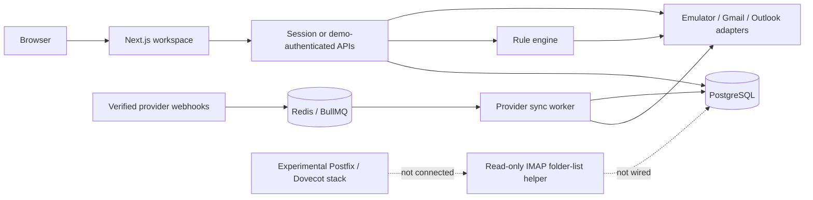

# Current architecture and technology

Snapshot: 2026-11-14, application commit `3aeb555`. This describes code that exists, not production readiness. See [CURRENT_HANDOFF.md](../CURRENT_HANDOFF.md) for the next implementation steps.

The local demo uses the database-backed emulator, synthetic messages and a deterministic model fallback. Gmail and Outlook sessions, provider adapters, token refresh, webhook handling and worker synchronization have been implemented and tested with simulated provider responses; live provider behavior is not verified. Initial provider import is paginated. Expired Gmail history, expired Microsoft subscriptions and crashed sync locks still need recovery.

## Components and boundaries

- **Workspace:** Next.js 16, React, TypeScript, Prisma/PostgreSQL and pnpm/Turborepo. Workspace, cleanup, digest and MCP APIs support scoped local-demo or authenticated access as appropriate. Do not expose demo authentication publicly.
- **Rule engine:** system/thread heuristics, static/group conditions, cold-email gate, then AI router. A static/group match with no instructions or OR may return deterministically; a hybrid AND rule with instructions requires both the deterministic match and AI selection. This is the user's later explicit requirement; the original checklist's unconditional learned-group bypass does not apply to hybrid AND rules.
- **Execution:** selection and draft generation are separate. Rule and action audit rows precede provider effects. Protected-sender and static-From guards apply, with undo only for supported reversible effects. Pilot mode blocks rule-driven sends and forwards, including previously queued jobs; standalone operators can explicitly disable pilot mode. Uncertain external effects require reconciliation, not blind retry.
- **Self-hosted mail:** [separate experimental Compose stack](../deploy/mailserver/README.md), encrypted owner-scoped credential storage, and [IMAP folder-list helper](../apps/web/utils/mail-provider/self-hosted-imap.ts) exist. The helper connects only to an operator-configured hostname using certificate-verified TLS and has mocked tests. It is not called by the provider resolver, an API or the workspace. No full IMAP/SMTP provider, synchronization, manual send, mailbox sign-in or invitations exist. A reviewed production schema migration is needed for `SelfHostedCredential`.
- **Workers:** the local delayed-action worker uses PostgreSQL polling; BullMQ/Redis handles real-provider notification jobs. Neither establishes that the incomplete self-hosted sync works.
- **Shared packages:** `mail-core`, `mail-sqlite`, `mail-ui` and `cli` contain usable primitives, but the browser SQLite cache and all shared UI primitives are not fully integrated into the workspace.

The existing application Compose stack uses `prisma db push`, not a reviewed migration workflow. The experimental mail-server Compose package has only had its configuration validated; no live mail-server security, delivery or backup/restore verification is claimed. For latest evidence and limitations see [STATUS.md](../STATUS.md) and [AUDIT_STATUS.md](AUDIT_STATUS.md).
